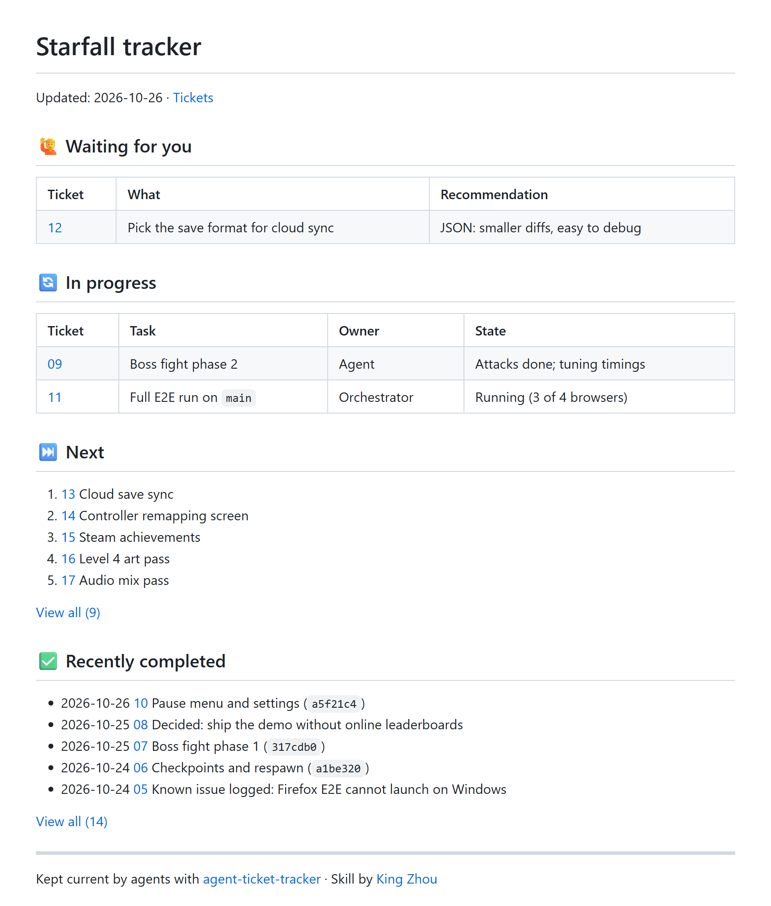

# agent-ticket-tracker

An agent skill that keeps one `TRACKER.md` at your repo root: a single page where you see what needs you, what is running, what comes next and what just finished. Your coding agents update it as they work. You only read it.



## What you get

- **🙋 Waiting for you:** questions and actions for you, each with the agent's recommendation.
- **🔄 In progress:** what is running now, who runs it and its state.
- **⏭️ Next:** the top 5 tickets from `.tracker/backlog.md`, with a link to the full list.
- **✅ Recently completed:** the last 5 results and decisions from `.tracker/history.md`, with a link to the full list.

Every line links to a ticket file that holds the detail. The skill uses your repo's ticket convention if it has one. If not, it keeps tickets in `.tracker/tickets/`.

## Install

Clone the repo into your agent's skills folder.

Claude Code:

```sh
git clone https://github.com/zym35/agent-ticket-tracker ~/.claude/skills/agent-ticket-tracker
```

Codex and other agents that read `~/.agents/skills`:

```sh
git clone https://github.com/zym35/agent-ticket-tracker ~/.agents/skills/agent-ticket-tracker
```

## Use

1. In your repo, ask your agent: "Set up a tracker for this project."
2. The agent creates `TRACKER.md` and `.tracker/`, adds a ticket for each piece of known work, and adds one line to `AGENTS.md` so every later session keeps the tracker current.
3. Work as usual. The agent updates the ticket and then the tracker each time a task starts, changes state, needs you or finishes.
4. Open `TRACKER.md` (Markdown preview works best) to check status. To answer an ask, reply in chat. The agent records your decision and moves the line to Recently completed.

By default, the tracker files are local only (in `.git/info/exclude`). Ask the agent to commit them if you want to share them.
